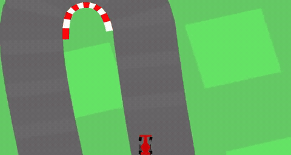
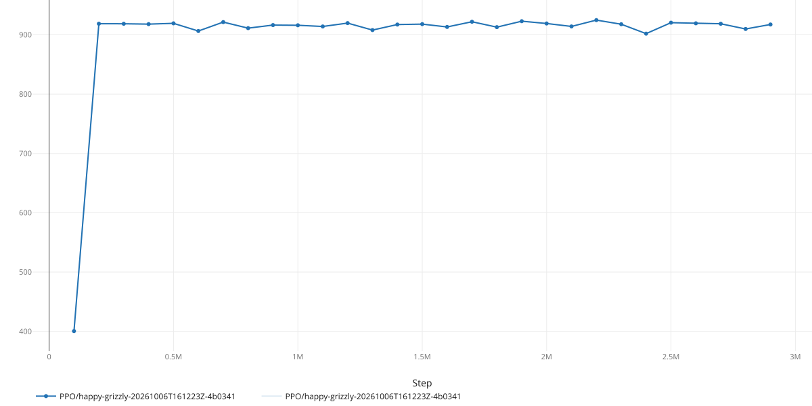
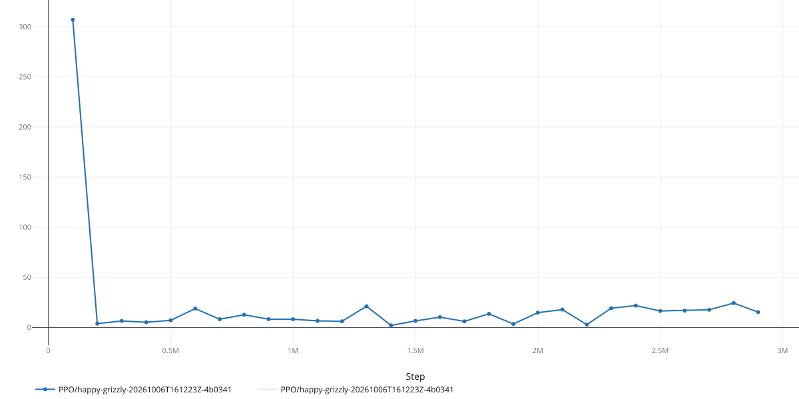
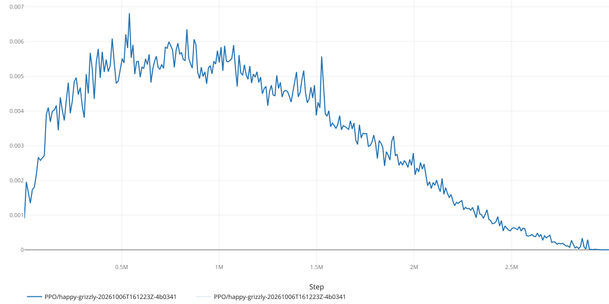
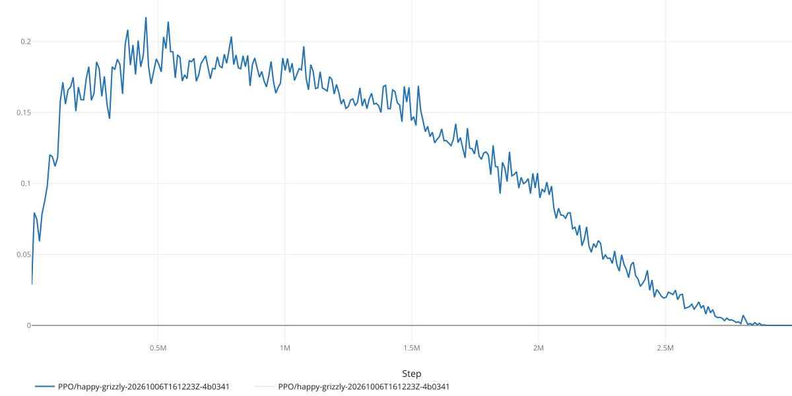
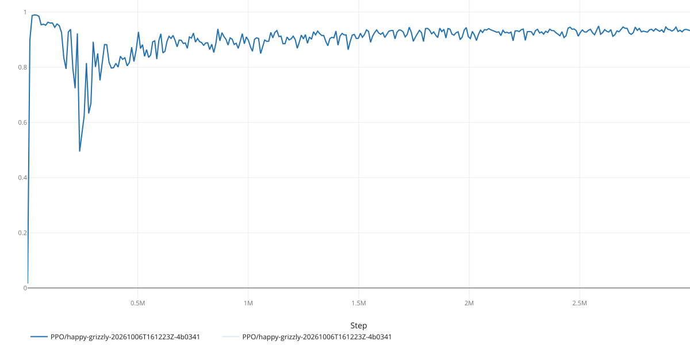
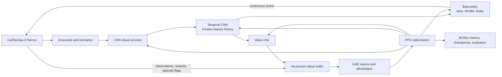

# TrackmaniaRL

**From-scratch visual reinforcement learning with PPO — starting in CarRacing-v3, with TrackMania planned.**

TrackmaniaRL is a PyTorch deep reinforcement learning project focused on
continuous control from pixels. It currently implements Proximal Policy
Optimization (PPO) for steering, throttle, and braking in Gymnasium's
`CarRacing-v3` environment. The policy, value network, rollout buffer, and PPO
training pipeline are implemented in this repository rather than delegated to
an off-the-shelf RL trainer. SAC and TrackMania/TMRL are planned extensions, not
implemented features.

**Current status:** PPO on CarRacing-v3 implemented and evaluated · SAC and
TrackMania are future work.



[View the original MP4](artifacts/best-run/rl-video-episode-22.mp4)

## Recorded result

The run shown in the plots below trained for **3 million vector-environment
steps** across **16 asynchronous environments** (48 million individual
environment transitions). Its deterministic final evaluation covered 1,000
episodes using the environment's raw reward:

| Evaluation | Result |
| --- | ---: |
| Mean episode return | **876.4** |
| Standard deviation | 102.5 |
| Episodes | 1,000 |
| Training seed | 2 |

This is a single-run snapshot, not a multi-seed benchmark or a claim that the
environment is solved. PPO results vary with the training run and configuration.

### Training and evaluation curves

Periodic evaluation uses 10 episodes; the final score above uses 1,000. The
charts are exports from the same MLflow run as that final evaluation.

| Evaluation performance | Evaluation variability |
| --- | --- |
|  |  |

| PPO policy update size | PPO clipping behavior |
| --- | --- |
|  |  |

| Value-function fit |
| --- |
|  |

## Selected experiment and checkpoint

The final experiment/checkpoint selection is intentionally left open until
evaluation runs have been compared. The selected checkpoint should be justified
by evaluation performance, rather than assumed to be the last training step.

| Selection detail | Value |
| --- | --- |
| MLflow experiment / run | PPO/happy-grizzly-20261006T161223Z-4b0341 |
| Selected checkpoint | 2200000 |
| Selection criterion | Evaluation over 100 episodes |
| Final evaluation | 906.095 +- 31.338 |
| Public model or run link | [state-dict](artifacts/best-run/step_2200000.pt) |

## How it works



### Engineering highlights

- **Policy matched to the action space:** a bounded Beta actor maps steering
  to `[-1, 1]` and throttle/brake to `[0, 1]` without treating the controls as
  a single symmetric action range.
- **Temporal visual input:** a CNN extracts image features and a temporal CNN
  processes a four-frame history before the actor and critic heads.
- **Careful episode-boundary handling:** GAE bootstraps through time-limit
  truncations while stopping advantage recursion at both truncations and true
  terminations. Temporal masks stay aligned with the observations used to
  choose actions under Gymnasium's same-step autoreset mode.
- **Reproducible training workflow:** strict YAML configuration, seeded runs,
  asynchronous vector environments, checkpoints, deterministic evaluation, and
  MLflow experiment tracking.
- **Tested algorithmic components:** pytest coverage includes PPO, rollout/GAE,
  network and actor behavior, configuration validation, and vector-environment
  autoreset handling.

## Technology

Python 3.13+ · PyTorch · Gymnasium · MLflow · Pydantic · uv

## Quick start

Choose one PyTorch build and use the same extra for subsequent commands. The
GPU extra is shown below; replace `gpu` with `cpu` for a CPU-only environment.

```bash
uv sync --extra gpu
uv run --extra gpu python scripts/train.py
uv run --extra gpu --extra dev pytest
```

The default configuration,
[`ppo_carracing.yaml`](src/rl_lib/config/ppo_carracing.yaml), launches a long
training run, not a smoke test. See [`docs/usage.md`](docs/usage.md) for short
diagnostic runs, evaluation, profiling, MLflow setup, benchmarks, and detailed
install/test instructions.

## Roadmap

- [ ] Implement **SAC** for CarRacing-v3 and compare it with PPO using a
  consistent evaluation protocol.
- [ ] Integrate **TrackMania through TMRL** and evaluate the agent on lap-time
  performance.
- [ ] Consider **TD3** as an optional algorithm comparison after PPO/SAC.

## More documentation

- [Usage and development instructions](docs/usage.md)
- [PPO metric reference](docs/metrics.md)
